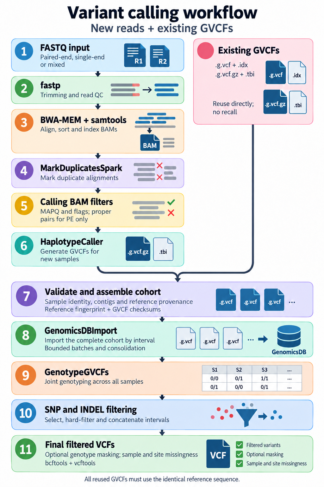

# Variant Calling Pipeline — v1.0.0

A Snakemake workflow for variant calling, incremental cohort reuse, and optional population and coverage analyses. It accepts paired-end, single-end, or mixed read libraries. Existing per-sample GVCFs are validated and reused; only samples without a reusable GVCF need alignment and calling.



[Release notes](docs/RELEASE_NOTES_v1.0.0.md) · [Short update for colleagues](docs/UPDATE_v1.0.0.md) · [Changelog](CHANGELOG.md)

## Configure one run

Run commands from this repository's root. Copy `config/config.yaml` to a local run config and replace the example paths:

```yaml
project:
  outdir: results
inputs:
  reference: data/reference.fasta
  samples_tsv: config/samples_examples.tsv
```

All relative paths resolve from the working directory, including metadata and sample lists. The reference directory must be writable for FASTA, sequence-dictionary and BWA indexes. Use simple sample IDs and paths without whitespace for the calling stages.

The configuration has seven numbered sections:

| Section | Settings |
| --- | --- |
| 1. Project and inputs | Reference, sample sheet and output directory |
| 2. Resources | Threads and memory in MB per stage |
| 3. Read processing | fastp and calling-BAM filters |
| 4. Variant calling | GATK, joint genotyping and GVCF reuse |
| 5. Filtering | Variant hard filters, optional genotype masking and missingness |
| 6. Population analyses | Separate **PCA**, **TREE** and **STRUCTURE/LEA** sections |
| 7. Coverage | Optional local coverage screening from sorted BAMs |

Older flat configs and the earlier combined `postprocessing.pca_tree` section remain supported. Explicit legacy keys override equivalent nested settings; prefer one format in new configs. See the [migration guide](docs/postprocessing.md#migrating-an-existing-configuration). Private species-specific configurations stay local and are not included in releases.

The sample sheet is tab-separated:

```text
sample      layout  R1                                  R2
isolate_01  paired  data/reads/isolate_01_R1.fastq.gz    data/reads/isolate_01_R2.fastq.gz
isolate_02  single  data/reads/isolate_02.fastq.gz
```

Use `config/samples_examples.tsv` as a template. `layout` accepts `paired` or `single`; leave `R2` empty for single-end reads. Older sheets with `sample`, `R1` and `R2` are supported by inferring layout from `R2`. Sample names must be unique. FASTQ discovery is also supported: set `inputs.samples_tsv: null`, then configure `inputs.fastq_dir` and `read_layout`.

## Install and run

Snakemake 9.5.1 was used for release validation. Install Snakemake and activate its environment before starting the workflow, so per-rule Conda activation selects the correct Python and R executables:

```bash
conda create -n variant-calling -c conda-forge -c bioconda \
  'snakemake-minimal>=8,<10' python=3.12
conda activate variant-calling
```

Inspect the planned jobs:

```bash
snakemake --snakefile workflow/Snakefile \
  --configfile config/config.yaml --use-conda --dry-run --cores 8
```

Execute or resume:

```bash
snakemake --snakefile workflow/Snakefile \
  --configfile config/config.yaml --use-conda \
  --cores 8 --resources mem_mb=32000 \
  --printshellcmds --latency-wait 30 --rerun-incomplete
```

Conda environments are under `workflow/envs/`. Set `resources` to suit your machine. `mem_mb` is a scheduling budget; GATK Java heaps and PLINK limits are configured within those budgets. Use `--rerun-incomplete` after an interrupted job. Changes in code, parameters, inputs or environments can legitimately schedule downstream recomputation.

## Variant calling and cohort reuse

The calling path is fastp → BWA-MEM/samtools → MarkDuplicatesSpark → calling-BAM filters → HaplotypeCaller → cohort validation → GenomicsDBImport → GenotypeGVCFs → interval SNP/INDEL filtering → concatenation → final VCFs.

Keep reusable GVCFs under `<outdir>/gvcf/`. Supported names are `<sample>.g.vcf.gz`, `<sample>.g.vcf`, and `<sample>.snps.indels.g.vcf[.gz]`, with `.tbi` for compressed files and `.idx` for uncompressed files. Missing indexes are generated; uncompressed legacy inputs are not recompressed. Duplicate sample identities are rejected.

The public config enables directory-wide cohort reuse:

```yaml
variant_calling:
  gvcf_reuse:
    enabled: true
    include_existing_samples: true
    validation_threads: 8
    allow_legacy_header_match: false
```

This combines all existing GVCFs with the current sample sheet. Reused samples do not need accessible FASTQs. Set `include_existing_samples: false` to restrict the cohort to sheet samples. The workflow currently requires a nonempty sample sheet or FASTQ discovery result, even when all listed samples already have GVCFs.

Validation checks sample identity, ordered contig names/lengths, gzip integrity and reference provenance. Reference and GVCF SHA-256 checksums are recorded. Strict validation rejects legacy inputs when the original reference is inaccessible and no valid sidecar proves identity. Enable `allow_legacy_header_match` only after independently confirming the same reference sequence. See [GVCF provenance](docs/gvcf_reuse.md).

Adding samples rebuilds GenomicsDB and downstream cohort results while retaining reused per-sample GVCFs. Imports use bounded batches (`variant_calling.joint.batch_size`, default 50) and optional consolidation. Use a fresh output directory or disable reuse to recall samples after changing calling parameters.

Hard-filter thresholds are study-specific. The public filters guard missing annotations and use floating-point thresholds to handle scientific notation. Genotype masking and heterozygote removal are disabled by default. `filtering.final.sample_max_missing` is a maximum missing fraction per sample; `filtering.final.max_missing` is a **minimum non-missing fraction per site**. SNPs and INDELs are filtered independently. If removing samples would remove the entire cohort, the current final-filter implementation retains them and records a warning. See [filter validation](docs/filter_validation.md).

## Population analyses

Set `postprocessing.enabled: true` to analyse the final SNP VCF. Each method has its own enable switch:

```yaml
postprocessing:
  enabled: true
  metadata:
    clades: metadata/clades.tsv
    rename: null
    clade_colors: null
  pca:
    enabled: true
    components: 20
    sample_list: null
  phylogenetic_tree:
    enabled: true
    method: nj
    layout: fan
    sample_list: null
  lea:
    enabled: true
    k_min: 2
    k_max: 20
    repetitions: 5
    best_k: auto
```

Keep the remaining options from the full template. PCA and TREE share variant selection and optional LD pruning, but have independent display sample lists. List files contain one original sample ID or renamed label per line; `null` displays all samples. Lists affect figures and the exported display scores, not the cohort used for PCA or tree inference. The Newick file retains the full inferred tree. Unmatched clade IDs appear as `Unclassified`.

TREE supports NJ/UPGMA on 1-IBS distances. LEA prepares LD-pruned genotypes, fits sNMF across a K range, and exports cross-entropy, Q matrices and admixture figures. PCA-only plotting is supported. Changing plot settings or final K reuses matching preparation/model results; changing genotypes, the model K range, repetitions or seed refits the model.

```bash
snakemake postprocessing --snakefile workflow/Snakefile \
  --configfile config/config.yaml --use-conda --cores 8
```

See [population analysis options and outputs](docs/postprocessing.md).

## Local coverage screening

Set `coverage_plots.enabled: true` to screen new and existing `.sorted.bam` files for local relative coverage changes:

```yaml
coverage_plots:
  enabled: true
  window_bp: 10000
  gc_correct: true
  smooth_windows: 5
  plot_min_contig_bp: null        # null = display sequences >= 50 kb
  chromosomes_per_row: 16
  outlier_quantiles: [0.01, 0.99] # null = full y range
```

Mosdepth calculates fixed-window coverage. Figures show raw depth and median-normalized log2 coverage, with optional GC correction and candidate gain/loss regions. They do not estimate absolute ploidy or provide statistical CNV calls. Zero-depth windows and extreme values remain in the analysis tables; robust figure limits mark out-of-range values with edge triangles. Short sequences can be hidden from figures without changing normalization, and long sequence lists wrap into multiple rows.

```bash
snakemake coverage_plots --snakefile workflow/Snakefile \
  --configfile config/config.yaml --use-conda --cores 8
```

The default input includes existing `<outdir>/bam/*.sorted.bam` files and BAMs for newly called samples. An explicit `bam_dir` selects existing sorted BAMs elsewhere. Existing BAM directories remain unchanged. Display-only changes reuse depth results. See [coverage methods, window sizes and limitations](docs/coverage_plots.md).

## Outputs

All results are under `project.outdir`:

- `trimmed/`, `bam/`, and `gvcf/`: read processing, alignments and per-sample calls;
- `provenance/`: reference fingerprint, per-GVCF metadata and validated cohort manifest;
- `joint/`, `genomicsdb/`, `snps/`, `indels/`: cohort and interval products;
- `final/filtered_snps.final.vcf.gz` and `filtered_indels.final.vcf.gz`, with indexes;
- `postprocessing/pca_tree/` and `postprocessing/lea/`: optional population analyses;
- `CoveragePlots/`: optional PNG/PDF figures, window tables, candidate regions and QC JSON;
- `logs/`: tool and stage logs.

## Validation and release contents

The release includes synthetic fixtures, regression tests and CI. Run the portable checks with:

```bash
python tests/structural_check.py
python -m unittest discover -s tests -p 'test_*.py' -v
snakemake --snakefile workflow/Snakefile \
  --configfile tests/minimal/config.yaml --lint
```

Tests requiring external tools skip when those tools are unavailable. The [release review](STRUCTURAL_REVIEW.md) records the checks actually run and their limits. Synthetic integration tests cover filtering, BAM coverage, PCA/tree and LEA preparation/model/plotting; a complete fresh-FASTQ biological validation is not claimed.

Release files include production workflow code, the portable config/sample-sheet template, documentation, the current diagram, CI and artificial tests. Private configs/sheets, real data/results, Conda caches, archived diagrams and generation prompts stay local. Publication readiness is tracked in [RELEASE_CHECKLIST.md](RELEASE_CHECKLIST.md).

## Maintainer

Verstrepen Lab — KU Leuven\
[https://verstrepenlab.sites.vib.be/en](https://verstrepenlab.sites.vib.be/en)\
Contact: [michael.abrouk@kuleuven.be](mailto:michael.abrouk@kuleuven.be)
